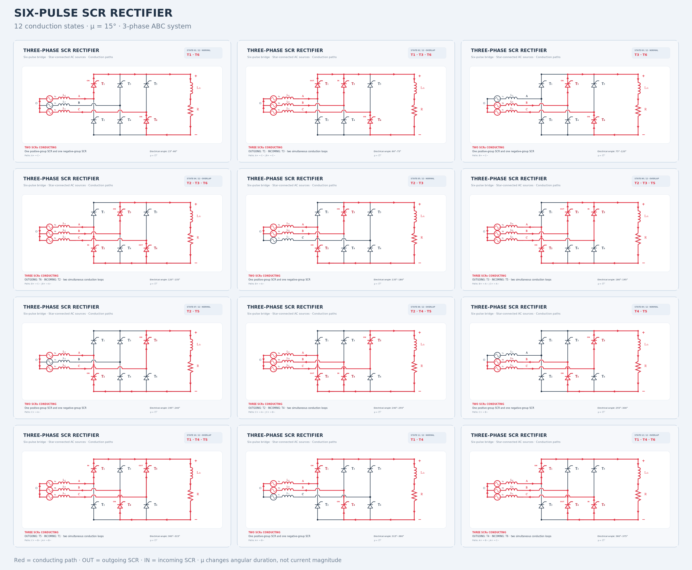
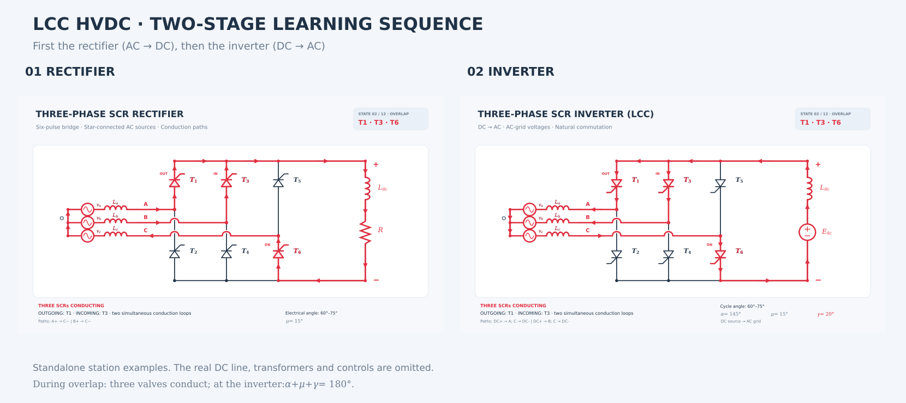
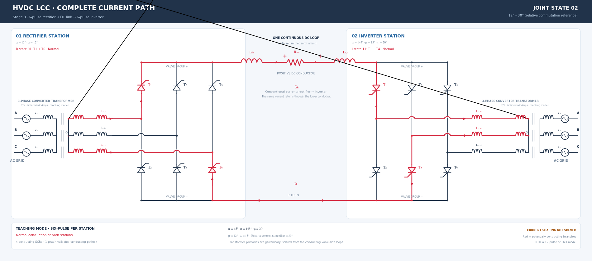
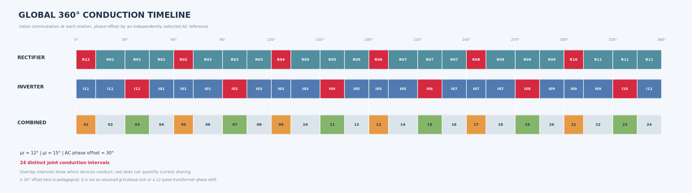
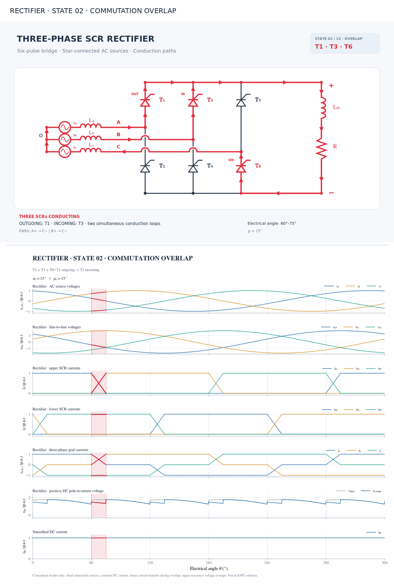

# Three-phase SCR rectifier — twelve conduction states

This project refactors the existing Python/Inkscape six-pulse rectifier into a **graph-validated, reusable SVG generator**. The output remains vector-based and editable in Inkscape.



## Quick start (Windows PowerShell / Command Prompt)

Install Python 3.10 or newer. Unzip the package and open a terminal inside its folder.

```bash
python retificador_trifasico_inkscape.py --all-12 --mu 15 --output-dir output
```

The generator has **no mandatory pip dependencies**. For the native SCR symbol as provided directly by the Schemdraw library, install:

```bash
python -m pip install schemdraw
python retificador_trifasico_inkscape.py --all-12 --mu 15 --require-schemdraw --output-dir output
```

When Schemdraw is unavailable, the original generator's embedded copy of the exact `schemdraw.elements.SCR` vector primitives is used. This fallback produces equivalent SVG geometry. On systems with Schemdraw installed, the program reads the native component segments.

## Outputs

The automatic command creates:

- `output/estado_01.svg` through `output/estado_12.svg`: complete independent editable drawings.
- `output/painel_12_estados.svg`: comparison panel containing **all twelve actual SVG geometries**, not raster thumbnails.
- `output/manifest_estados.json`: SCR lists, active sources/reactors, conductor IDs, angular windows, graph-edge directions, outgoing/incoming SCRs.
- `output/manifest_estados.csv`: compact state inventory.

The distributed `output` folder also contains PNG preview images. PNGs are previews only; use SVG for editing.

## Other modes

```bash
# One normal / overlap state, for example T1 + T3 + T6:
python retificador_trifasico_inkscape.py --state 2 --mu 20 --output estado_02_mu20.svg

# Read sequence parameters from a JSON file:
python retificador_trifasico_inkscape.py --config config_sequencia.json

# Legacy interface: six ideal states with only two SCRs each:
python retificador_trifasico_inkscape.py --all --output-dir output_ideal
python retificador_trifasico_inkscape.py --step 1 --output etapa_ideal.svg

# Preserve manual selection using the existing Portuguese-key JSON:
python retificador_trifasico_inkscape.py --config configuracao_retificador.json --output selecao_manual.svg

# Override an automatic state for custom instructional highlighting:
python retificador_trifasico_inkscape.py --state 2 --thyristors T1,T6 --output custom.svg

# List individually selectable components and wire segments:
python retificador_trifasico_inkscape.py --list-parts
```

**Note:** modifying an automatic state with manual component/path overrides changes the legend to `CUSTOM SELECTION`, because its coloring may no longer represent a physically valid current state.

## Complete sequence — ABC phase order

T1/T3/T5 are the upper SCRs, T2/T4/T6 are the lower SCRs. All SCR symbols are oriented with the anode below and cathode above in the drawing.

| State | SCRs in conduction | Type | Entering / leaving |
|---|---|---|---|
| 01 | T1 + T6 | normal | — |
| 02 | T1 + T3 + T6 | overlap | T3 enters / T1 leaves |
| 03 | T3 + T6 | normal | — |
| 04 | T3 + T6 + T2 | overlap | T2 enters / T6 leaves |
| 05 | T3 + T2 | normal | — |
| 06 | T3 + T5 + T2 | overlap | T5 enters / T3 leaves |
| 07 | T5 + T2 | normal | — |
| 08 | T5 + T2 + T4 | overlap | T4 enters / T2 leaves |
| 09 | T5 + T4 | normal | — |
| 10 | T5 + T1 + T4 | overlap | T1 enters / T5 leaves |
| 11 | T1 + T4 | normal | — |
| 12 | T1 + T4 + T6 | overlap | T6 enters / T4 leaves |

The sequence repeats cyclically. Each SCR pair defines a complete loop through the DC load and back through the star-connected AC sources. During overlap the program takes the **union of two valid loops** and highlights the two transferring phases, the stationary phase, and the shared conductors.

### Angular convention

With the angle origin chosen at the start of the overlap immediately preceding state 01:

- Normal state for sector *i*: `[60(i − 1) + μ, 60i]` electrical degrees.
- Overlap state for sector *i*: `[60i, 60i + μ]` electrical degrees.
- State 12 extends past `360°`; its terminal portion wraps to the beginning of the next cycle.

The 12-state mode accepts only `0 < μ < 60°`. There is no simultaneous two-group overlapping commutation in this simplified model. For `μ = 0°`, use `--all` to get the six ideal conducting pairs.

### Important limitation

**This is a topology and schematic visualization tool, not an EMT simulator.** The red paths and arrows represent possible conducting branches and conventional-current directions. In overlap states, the two branches do not necessarily carry equal currents; signed traversal counters in the manifest count paths, **not actual amperes or current-sharing ratios**. `μ` changes annotation intervals only and does not calculate current waveforms or the operating point. A physical model for commutation reactance, firing angle, source voltages, and DC current would be required for realistic instantaneous currents.

## Architecture

- `rectifier_model.py`:
  - `CircuitTopology`: graph of wires, AC sources, reactors, SCRs and load; checks continuity and SCR forward conduction.
  - `ConductionState`: structured list of conducting pairs, SCRs, angle window, entering/leaving SCRs.
  - `CommutationSequence`: automatic creation of six pairs plus six overlaps, with cyclic invariants.
  - `Highlight`: graph-derived sets and signed branch directions.
- `rectifier_art.py`: reused geometry, editable mathematical labels, `schemdraw.elements.SCR` primitive extraction/fallback, American zigzag resistor, source and inductor symbols, overhead wire jumps.
- `rectifier_renderer.py`:
  - `CircuitRenderer`: draws any state with shared component definitions and correct arrows.
  - `StyleManager`: consistent fonts, colors and on-wire arrow geometry.
  - `build_panel`: editable group composition with unique SVG IDs and isolated arrow markers.
- `retificador_trifasico_inkscape.py`: argument parser, old/modern JSON configuration, legacy modes and batch export.
- `tests/test_sequence.py`: automated topology, commutation, compatibility and SVG tests.

## Validation

If pytest is available:

```bash
python -m pip install pytest
python -m pytest -q tests
```

All 15 tests passed in the provided environment. Visual PNG preview generation and checks were carried out with CairoSVG (used only during package preparation and not required by the SVG generator).

All Python comments and docstrings are in English. Visual labels and component annotations are in English, and symbols use mathematical typesetting with editable SVG text (`STIX Math`, with compatible fallbacks).

---

## New: LCC inverter teaching figures (stage 2)

This release preserves the original rectifier tool and adds a **bidirectional
LCC learning sequence**: first the rectifier (AC to DC), then the inverter
(DC to AC), showing the same 12 valve conduction and commutation-overlap
states in each mode. The inverter includes a polarity-corrected set of SCRs,
a driving DC voltage source in place of the rectifier's resistor, and a
validated extinction angle.



**One-command demonstration:**

```bash
python lcc_converter.py --side both --alpha 145 --mu 15 --output-dir output_lcc
```

This creates `output_lcc/rectifier/` and `output_lcc/inverter/`, each with
12 independent, editable SVGs, an SVG comparison panel and two manifests. It
also writes `output_lcc/lcc_two_stage_overview.svg`.

To generate only the inverter:

```bash
python lcc_converter.py --side inverter --alpha 145 --mu 15 --output-dir output_lcc/inverter
```

Parameters can also be supplied in JSON:

```bash
python lcc_converter.py --config config_inversor.json
```

The inverter example uses **alpha = 145°, mu = 15° and gamma = 20°** with
`gamma_min = 10°`, applying `alpha + mu + gamma = 180°` and rejecting
inadmissible extinction-angle margins. Current paths are topological,
not waveforms or an EMT simulation.

The legacy `retificador_trifasico_inkscape.py` and its original command-line
arguments remain supported.

For the topology, the opposite SCR polarity, details of voltage conventions,
limitations, and usage commands, see
[docs/LCC_INVERTER_GUIDE.md](docs/LCC_INVERTER_GUIDE.md).

---

## Stage 3 — Complete two-terminal HVDC LCC link

**New:** `hvdc_link.py` connects the educational rectifier and inverter
bridges through a physically closed, **two-conductor metallic-return** DC loop.
The vector schematic includes **isolated converter transformers, leakage
inductances, one smoothing reactor at each station, a DC line resistor and
all twelve SCRs**. Red paths follow directed, validated electrical loops
across **both** stations, including overlap on either or both ends.





**Generate the full demonstration:**

```bash
python hvdc_link.py --config config_hvdc.json --all --output-dir output_hvdc
```

**Optional PNGs:** `python -m pip install cairosvg`, then add `--png`.

**Select one instant:**

```bash
python hvdc_link.py --theta 66 --output-dir output_hvdc
```

**Independent inverter extinction-angle setting:**

```bash
python hvdc_link.py --alpha-r 15 --gamma-i 20 --mu-r 12 --mu-i 15 --phase-offset 30
```

For the example (`μr=12°`, `μi=15°`, illustrative `30°` AC offset), the
shared timeline has **24 distinct intervals**. The number changes when
station overlap windows coincide. At each instant the highlighted complete
path contains four SCRs normally, five during one station overlap and six
if both stations overlap. These counts are topological, not solved currents.

**This is still a pair of six-pulse stations, not an industrial 12-pulse
Y/Y + Y/Δ converter.** The transformer primary and secondary are isolated
and the second DC conductor is an actual metallic return. The offset between
stations is an illustrative AC-reference choice independent of firing delay.

See **[docs/HVDC_FULL_LINK_GUIDE.md](docs/HVDC_FULL_LINK_GUIDE.md)** for
topology conventions, architecture, output files, validation and limitations.


## Audited figure conventions (October 2026)

- Electrical paths are traced through directed SCRs and the idealized transformer secondary windings.
- The three-phase transformer primaries and AC grids are **symbolic terminal drawings**; they are not a solved network, and no transformer equivalent circuit or primary current is calculated.
- SCR reference labels use `T₁` through `T₆`; station identity comes from the panel heading.
- Scalar variables, including Greek letters `α`, `μ`, `γ`, and `v`, are *italic*. Indices identifying functions such as `dc`, `line`, `r`, and `i` are upright, while phase-variable indices are italic.
- Physical units (for example `°`, `V`, `A`, `Ω`, `Hz`) are upright. Matrix names use **bold upright** letters through `rectifier_art.matrix_label`.
- Editable mathematical expressions are assembled from contiguous SVG `<tspan>` elements. `rectifier_art.indent_svg` prevents unwanted XML whitespace between glyphs.
- The existing configuration key `ac_phase_offset` controls an **illustrative relative commutation-timeline offset**, not a calculated phase difference between the AC grids. The firing delays are parameter annotations; changing `α` alone does not calculate a new phase-locked time schedule.
- In overlap states, red means a possible conducting branch, not equal currents or a calculated instantaneous division.

Audit and regenerate all galleries with the commands in `docs/FIGURE_AUDIT.md`.

---

## Stage 4: Conceptual conduction waveforms (48 synchronized figures)

The waveform extension adds **12 rectifier**, **12 inverter** and **24 HVDC joint-state** charts, with corresponding fully editable combined circuit+waveform SVG sheets. PNG previews are also provided. The original circuit figures remain available.



```bash
python -m pip install -r requirements-waveforms.txt
python generate_lcc_waveforms.py --config config_waveforms.json --side all
python -m pytest -q tests
```

- `output_lcc/rectifier/waveforms/` and `output_lcc/rectifier/sheets/`
- `output_lcc/inverter/waveforms/` and `output_lcc/inverter/sheets/`
- `output_hvdc/waveforms/` and `output_hvdc/sheets/`

The current transfer is an illustrative linear interpolation during overlap and the DC voltage is a simplified equal-reactance arithmetic average, **not an EMT solution**. The inverter voltage chart uses a positive pole-to-return convention; the negative signed converter voltage is the opposite quantity. The full-link phase offset remains illustrative, not physically solved.

[Detailed model, limitations and notation](docs/LCC_DIDACTIC_WAVEFORMS.md)

---

## Stage 0 — Pure R load followed by RL

The teaching sequence now starts with a purely resistive load (ideal AC sources and μ = 0°), moves through α = 0°, 30°, 75° and 90° with explicit zero-current intervals, and compares those states against the dynamic RL load before the original LCC commutation sequence.

- [R/RL editable diagrams and waveforms](output_lcc/rectifier/resistive_load/)
- [Electrical assumptions and the six-pulse gating sequence](docs/RECTIFIER_R_RL_TEACHING.md)
- [Interactive HTML and clickable PowerPoint build](presentation/README.md)

Run `python rectifier_loads.py` to regenerate the vector figures; run `python presentation/build_presentation.py --project . --output dist/lcc_hvdc_interactive.html` to produce the offline lecture. The GitHub Actions workflow publishes the HTML and PPTX as downloadable artifacts.

## HTML teaching extension: R, RL, LE, RLE and six SCR A-K voltages

The offline HTML teaching presentation now includes four selectable DC loads and ideal valve anode-cathode voltages with forward blocking, reverse blocking and explicitly unresolved intervals. The presentation has a restrained **Siemens PTI-inspired** technical-document layout, but is independent educational material without official corporate branding. Current CI publishes only HTML; legacy PPTX scripts are not executed. See [technical notes](docs/rectifier-loads-and-scr-voltage.md).

## Advanced HTML lecture — four DC loads and SCR voltages

The current offline presentation introduces ideal rectifier loads **R**, **RL**, **LE** (initial-value, undamped), and **RLE** (DC-link equivalent with opposing source). It adds individual SCR anode–cathode voltages, including undefined values for floating DC terminals, dynamic angle-window shading, continuous sliders, and distinguishable line patterns. The independent navy/teal document design is inspired by technical power-system consulting materials; it is **not official Siemens PTI material**.

Generate figures: `python lcc_advanced_figures.py --output-dir output_lcc/rectifier/advanced_loads`.
Build the standalone offline HTML: `python presentation/build_presentation.py --project . --output dist/lcc_hvdc_interactive.html`.
Run model and browser tests: `python -m pytest -q tests presentation/tests` and `python presentation/tests/browser_smoke.py` (requires Playwright/Chromium).

[Technical assumptions and limitations](docs/ADVANCED_LOADS_SCR_VOLTAGES.md) · [Advanced editable figures](output_lcc/rectifier/advanced_loads/)

**No PPTX is produced by this release or by its HTML-only CI workflow.**
